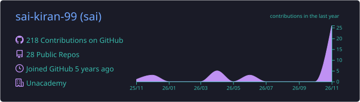
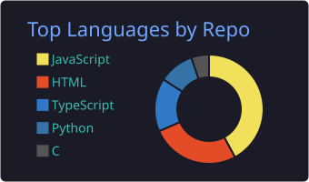
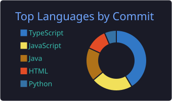
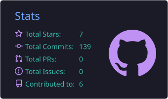
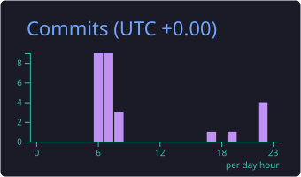

<div align="center">


<p>
  <a href="https://sai-s-portfolio-two.vercel.app"></a>
  <a href="https://linkedin.com/in/saikiranmadala"></a>
  <a href="mailto:saikiranmadala5555@gmail.com"></a>
  <a href="https://leetcode.com/u/saikiranmadala"></a>
</p>


</div>

## 👋 About me


Frontend engineer with **2.5+ years** shipping production features at **Unacademy · Graphy**, a creator-commerce SaaS platform for course businesses. I build AI-powered product surfaces with **React, Next.js and TypeScript**, and care about fast, accessible UIs.

- 🧩 Architected the **AI Website Builder**: prompt-based + manual editing, live preview, version history → **60% faster** site setup
- ⚡ Led the **Next.js 15 App Router** migration → **20% better LCP**
- 💬 Shipped **WhatsApp Campaigns** with AI-assisted approvals in 2 sprints, zero post-launch defects
- 🤖 Automated **AI support escalation** with human handover → **30% smaller** support backlog

<br clear="right" />

## 💼 Professional journey

<div align="center">


<table>
  <tr>
    <td align="center" width="33%">
      
      <br/><sub><b>Unacademy · Graphy</b><br/>Sep 2024 – Present</sub>
    </td>
    <td align="center" width="33%">
      
      <br/><sub><b>Unacademy · Graphy</b><br/>Mar 2024 – Sep 2024</sub>
    </td>
    <td align="center" width="33%">
      
      <br/><sub><b>Frontend + AI features</b><br/>React · Next.js · TypeScript</sub>
    </td>
  </tr>
</table>

</div>

```text
2024 Jan ─ Mar   Frontend Intern          Academor               Responsive React + Tailwind UI
2024 Mar ─ Sep   Frontend Intern          Unacademy · Graphy     OTP login (+10% completion), shared components
2024 Sep ─ now   Software Engineer, FE    Unacademy · Graphy     AI Website Builder, Next.js 15 migration, AI features
```

## 🚀 Featured project

<table>
  <tr>
    <td width="100%">
      <h3><a href="https://codereview-ai-silk.vercel.app">CodeReview AI</a></h3>
      <p>Paste code and get an AI code review <b>streamed live</b>: every issue with severity, line number and a suggested fix. Auth, review history and tests included.</p>
      <p></p>
      <p><b>Gemini API</b> · <b>SSE streaming</b> · <b>zod-validated LLM output</b> · <b>JWT auth</b></p>
      <p>
        <a href="https://codereview-ai-silk.vercel.app"></a>
        <a href="https://github.com/sai-kiran-99/codereview-ai"></a>
      </p>
      <p><sub>Next: repo-aware reviews with RAG (MongoDB Atlas Vector Search) and a PR-review agent.</sub></p>
    </td>
  </tr>
</table>

## 🛠️ Tech stack

**Frontend**


**Backend & data**


**Tools**


**AI:** Gemini & OpenAI APIs · streaming responses (SSE) · structured LLM output · RAG (in progress)

## 📊 GitHub analytics

<div align="center">


<br/><br/>









<br/><br/>


</div>

## 🌱 Currently

- Building **RAG** and **agent** features into CodeReview AI
- Deepening **system design** and **performance** for large frontend apps

<div align="center">


</div>
